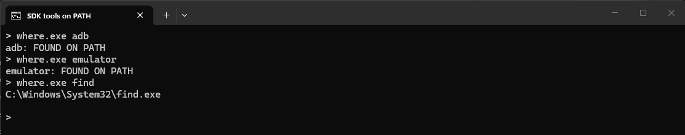
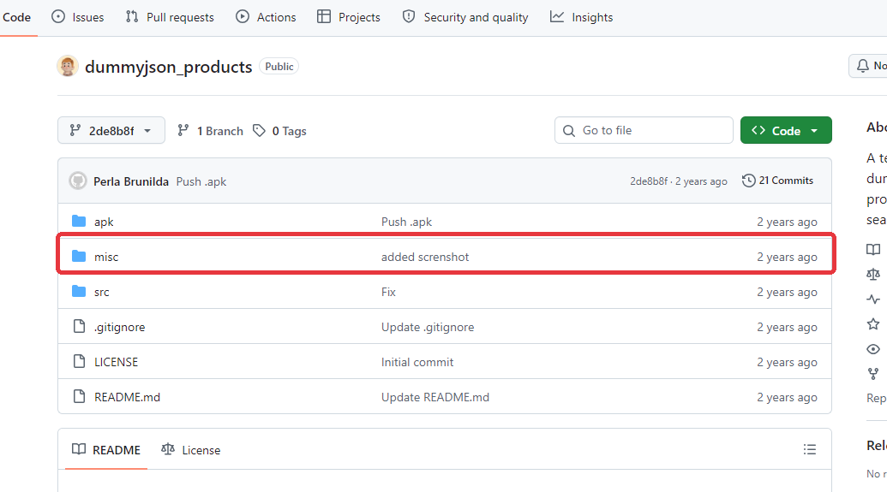
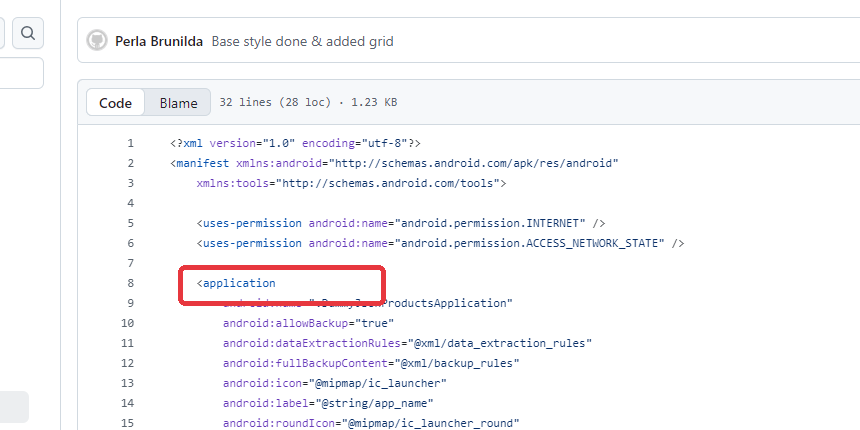
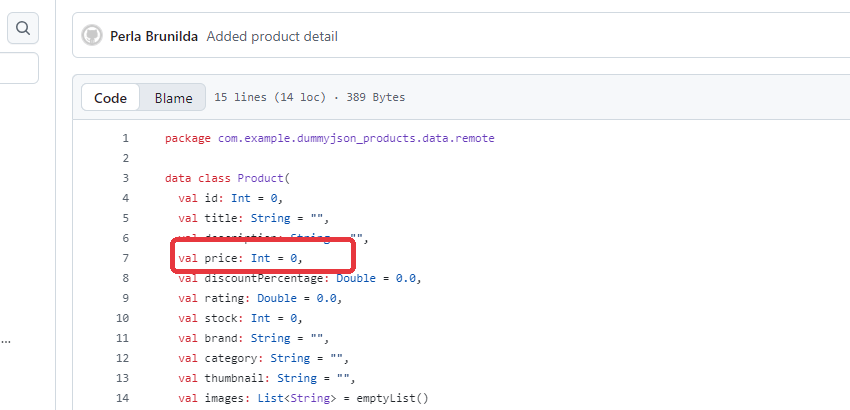
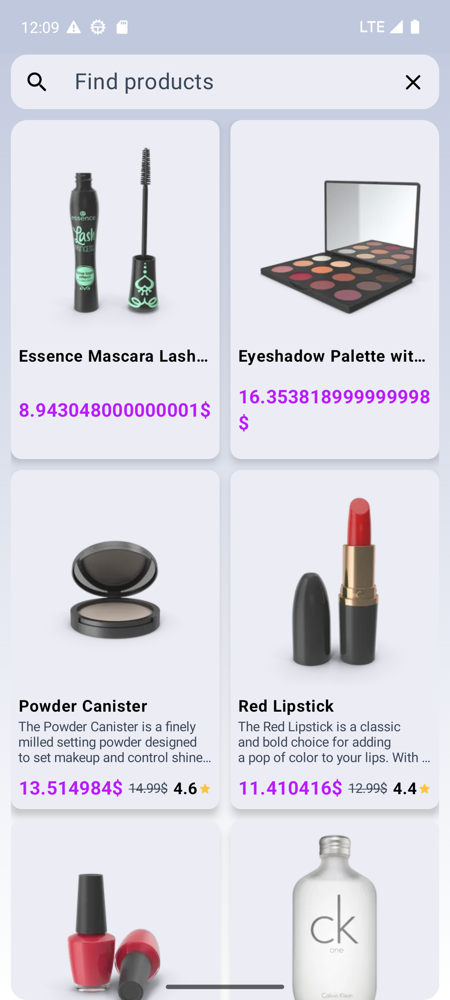

# 1. Build and launch the sample app

[Overview](index.md) · [Next: intercept HTTPS](02-https-interception.md)

You need [Android Studio](https://developer.android.com/studio) with Android SDK Platform Tools, Emulator, and an Android 13 / API 33 Google APIs x86_64 image; [Python 3](https://www.python.org/downloads/); [mitmproxy](https://docs.mitmproxy.org/stable/overview/installation/); JDK 17; and Gradle 8.13. I used Windows 11, `adb` 36.0.0, Emulator 36.2.12, mitmproxy 12.1.2, and Python 3.12.5. Add the SDK's `platform-tools` and `emulator` folders to `PATH`, or call their executables by full path.



## Create the emulator

In Android Studio, open **Device Manager → Create device**, choose **Pixel 6**, then the **API 33 Google APIs x86_64** image. Start it and check:

```powershell
adb devices
adb shell getprop ro.build.version.sdk
```

The second command should return `33`. Keep one emulator running while following the guide.

## Get the app

The sample is open source, so you can rebuild it. The manifest and `Product.kt` edits below make it trust a user CA and parse the current API. A closed APK won't trust a CA just because you installed one; for those apps, see [system CA trust](06-rootavd-magisk.md) and [pinning](07-certificates-and-pinning.md).

```powershell
git clone https://github.com/Hasuk1/dummyjson_products.git
cd dummyjson_products
git checkout 2de8b8ff7fb313e16742117ac31b7c66dfe86e51
cd src
```



Add debug-only trust for the proxy CA in the sample app. In `app/src/main/AndroidManifest.xml`, add this attribute to its existing `<application>` element:

```xml
android:networkSecurityConfig="@xml/network_security_config"
```



Create `app/src/main/res/xml/network_security_config.xml`:

```xml
<?xml version="1.0" encoding="utf-8"?>
<network-security-config>
    <debug-overrides>
        <trust-anchors>
            <certificates src="user" />
        </trust-anchors>
    </debug-overrides>
</network-security-config>
```

The live API returns decimal prices. In `app/src/main/java/com/example/dummyjson_products/data/remote/Product.kt`, change `val price: Int = 0,` to `val price: Double = 0.0,`. Without this change, the app cannot parse products such as one priced `9.99`. The app's existing UI may show more decimal places than you expect; this does not affect capture.



## Build and install

This revision lacks `gradle-wrapper.jar`, so use an installed [Gradle 8.13](https://gradle.org/releases/) with JDK 17. Set the paths to your installations:

```powershell
$env:JAVA_HOME = 'C:\path\to\jdk-17'
$env:ANDROID_HOME = "$env:LOCALAPPDATA\Android\Sdk"
& 'C:\path\to\gradle-8.13\bin\gradle.bat' :app:assembleDebug
adb install -r .\app\build\outputs\apk\debug\app-debug.apk
adb shell monkey -p com.example.dummyjson_products 1
```

The app may report a network error until you install the CA in [chapter 2](02-https-interception.md). Once the CA is installed, reopening the app should show products:



Android applies `debug-overrides` only to debuggable builds ([network security configuration](https://developer.android.com/privacy-and-security/security-config)). A release build of the same app would ignore it.
