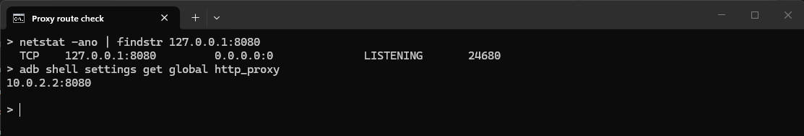
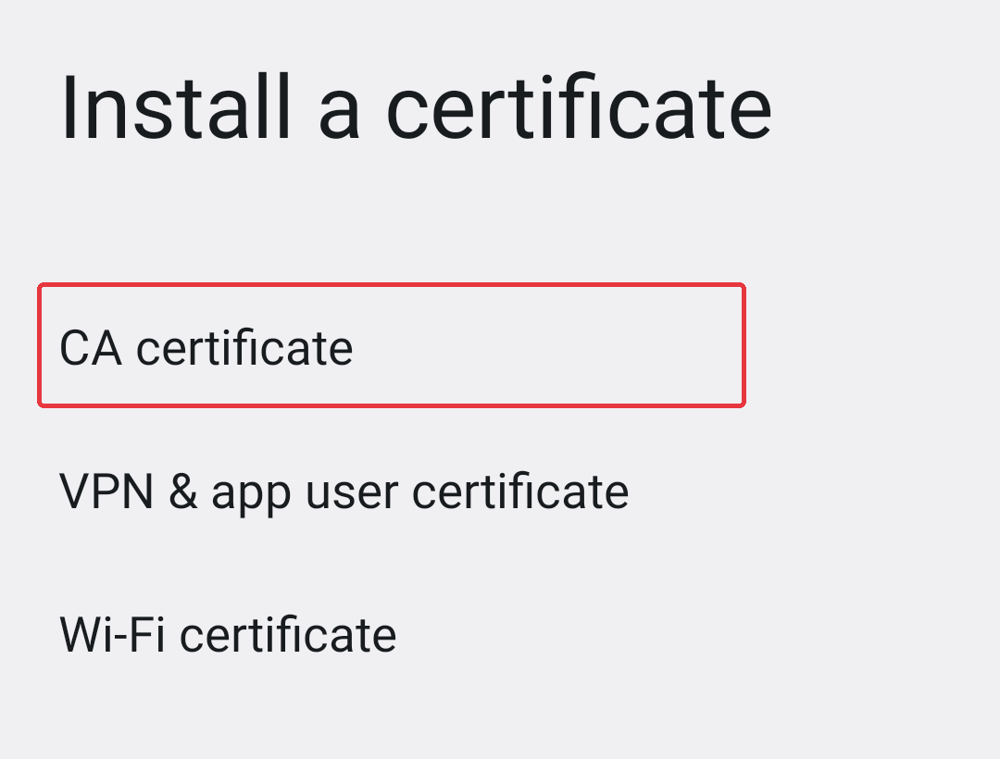
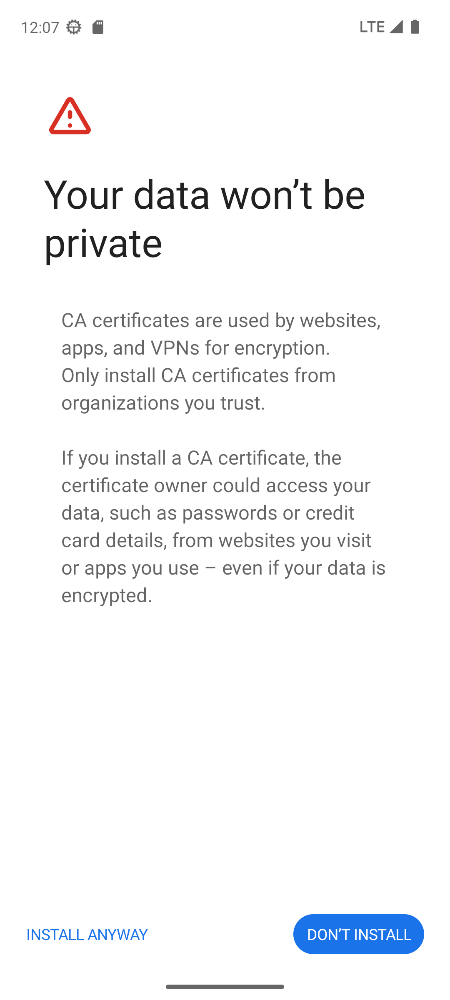
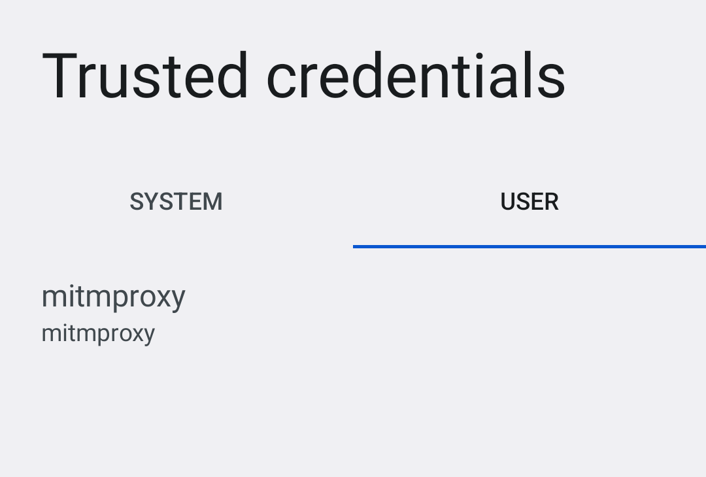

# 2. Intercept the app's HTTPS requests

[Previous: build the app](01-environment-setup.md) · [Next: read the API](03-api-discovery.md)

The emulator must send traffic through mitmproxy, and the debug app must trust mitmproxy's CA. Run these steps with the API 33 emulator from chapter 1.

## Start the proxy

In PowerShell, from a folder where you can keep the capture private:

```powershell
mitmdump --listen-host 127.0.0.1 --listen-port 8080 -w .\capture.mitm
```

Leave it running. In another PowerShell window, set Android's system proxy:

```powershell
adb shell settings put global http_proxy 10.0.2.2:8080
adb shell settings get global http_proxy
```

The check should print `10.0.2.2:8080`. In the emulator, `10.0.2.2` reaches the Windows host's loopback interface; `127.0.0.1` would mean the emulator itself. Set the proxy inside Android, not in the emulator's own proxy settings. The emulator setting tunnels HTTPS, so mitmproxy can't decrypt it ([emulator proxy guide](https://developer.android.com/studio/run/emulator-networking-proxy)).



## Install mitmproxy's public CA

After mitmproxy's first run, push its public certificate to Android:

```powershell
adb push "$env:USERPROFILE\.mitmproxy\mitmproxy-ca-cert.cer" /sdcard/Download/mitmproxy-ca-cert.cer
```

On the Pixel 6 / API 33 image, open **Settings → Security → More security settings → Encryption & credentials → Install a certificate → CA certificate**. Confirm the warning and choose the `.cer` file from Downloads. Use **CA certificate**, not Wi-Fi certificate.





Verify the certificate appears under **Trusted credentials → User**:



Android puts this certificate in the **User** store. The sample's `debug-overrides` lets its debug build trust that store; many release apps use only **System** CAs. Installing a user CA does not change their trust settings. See [mitmproxy's certificate guide](https://docs.mitmproxy.org/stable/concepts/certificates/) for the public certificate and private key files.

## Trigger a readable request

From the cloned project's `src` directory, restart the debug app:

```powershell
adb shell am force-stop com.example.dummyjson_products
adb shell monkey -p com.example.dummyjson_products 1
```

Open the product list, tap a product, and search for `phone`. The proxy should show `GET https://dummyjson.com/products/...` with readable JSON. If you see only `CONNECT`, TLS decryption has not worked yet. [Chapter 3](03-api-discovery.md) shows the captured requests.

If the app still shows a network error, use [troubleshooting](troubleshooting.md) to check the proxy route and CA trust. The same page has cleanup steps for when you finish.
