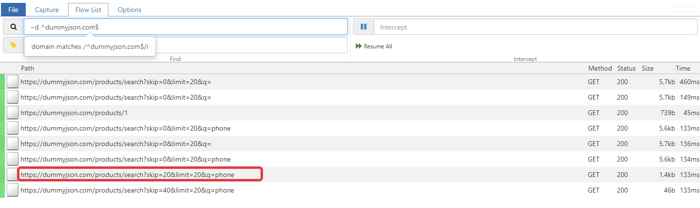
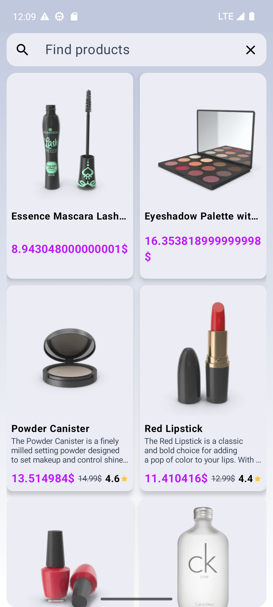
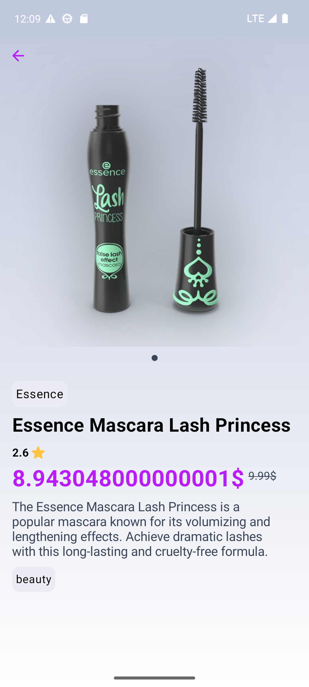
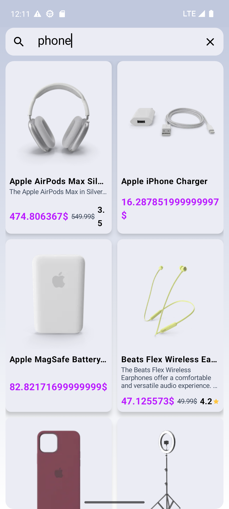
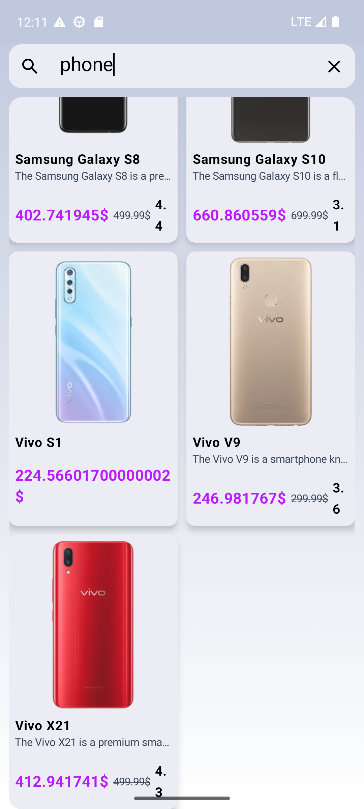
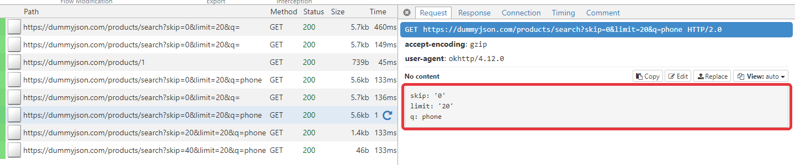

# 3. Find the API behind each screen

[Previous: intercept HTTPS](02-https-interception.md) · [Next: export with Python](04-python-scraper.md)

With the debug app and proxy running, perform one action at a time. Stop mitmdump after the capture, then open its archive with the mitmweb command in the [visual guide](index.md). Filter with `~d ^dummyjson.com$` and match the new `/products` request to the action you just took.



## Open the product list

{ width="360" }

The launch request was:

```http
GET https://dummyjson.com/products/search?skip=0&limit=20&q=
```

The response has a `products` array plus `total`, `skip`, and `limit`. The captured first page held 20 products; `total` was 194 at capture time. Compare the [sanitized response](../examples/sanitized-responses/list-page-0.json).

## Open one product

{ width="360" }

Tapping the first item produced `GET https://dummyjson.com/products/1`. Its response is one product object, rather than a `products` array. Compare the [sanitized detail](../examples/sanitized-responses/product-1.json).

## Search, then scroll

{ width="360" }

Searching `phone` sent `GET /products/search?skip=0&limit=20&q=phone`. The response reported `total: 23`: 20 products on the first page.

{ width="360" }

Scrolling sent the same request with `skip=20` and returned the remaining 3 products. The app also made a `skip=40` request, which returned no products. A scraper can stop when its collected count reaches `total`. See the sanitized [first](../examples/sanitized-responses/search-phone-page-0.json) and [second](../examples/sanitized-responses/search-phone-page-1.json) pages.



The useful contract is just two endpoints:

| Request | Meaning |
| --- | --- |
| `GET /products/search?q=…&skip=…&limit=…` | List or search, in pages |
| `GET /products/{id}` | One product's details |

The captured requests needed no authentication header. Do not copy incidental client headers into the scraper. The sample app's [Retrofit interface](https://github.com/Hasuk1/dummyjson_products/blob/2de8b8ff7fb313e16742117ac31b7c66dfe86e51/src/app/src/main/java/com/example/dummyjson_products/data/DummyJsonApi.kt) confirms the routes, but the screen-to-request mapping above came from the live capture. Totals may change when the API data changes.
