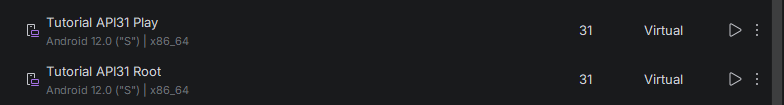
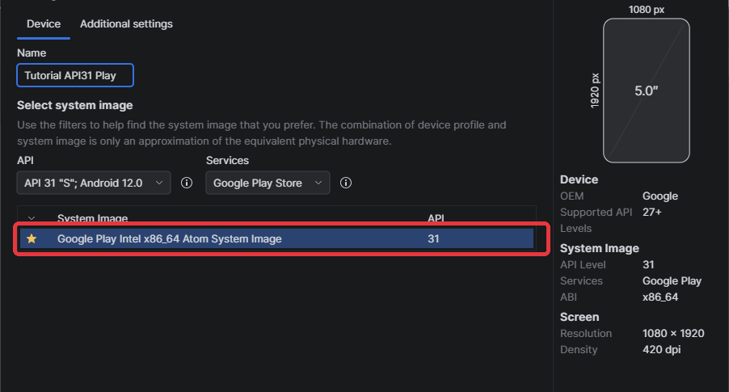
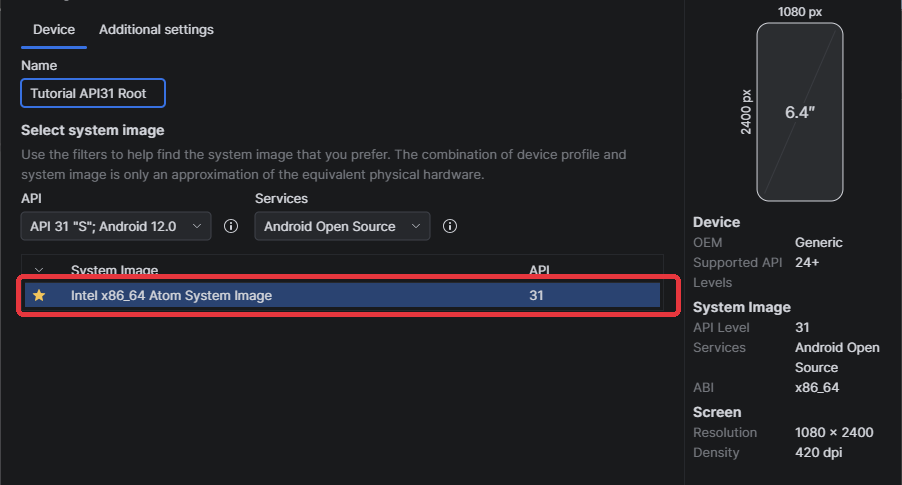
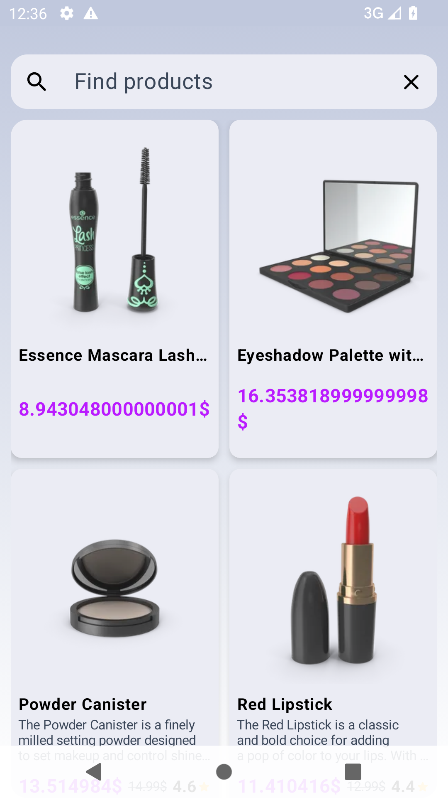
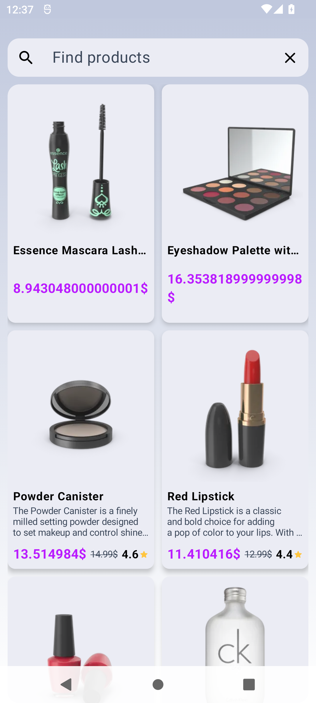
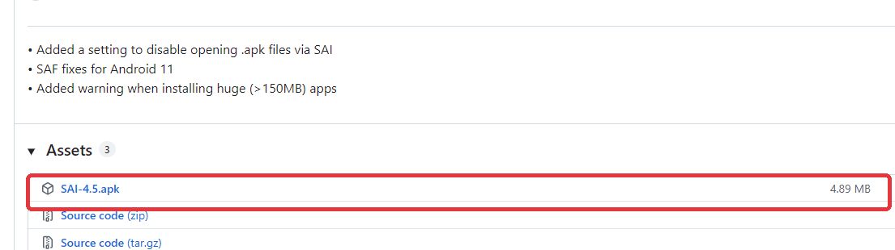
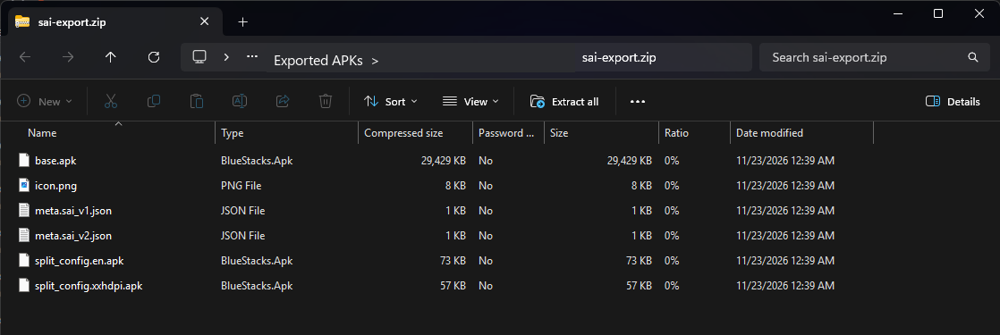
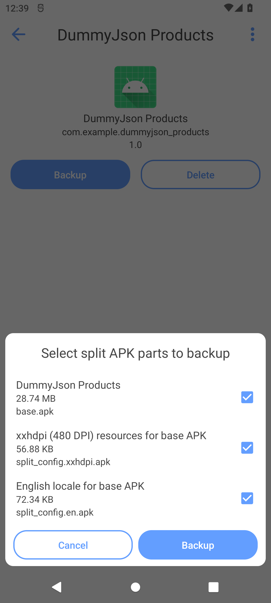
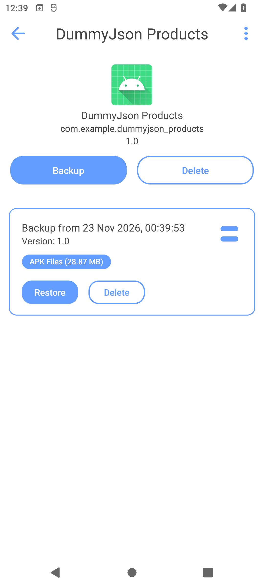

# 5. Transfer a split APK between emulators

[Previous: Python exporter](04-python-scraper.md) · [Next: Magisk](06-rootavd-magisk.md)

Skip this chapter if the rebuilt sample app and user CA from chapters 1 to 4 already give you the traffic you need. Otherwise you'll want two emulators: a Google Play one for apps that need Play services, and an AOSP one for a root shell. Both devices must have the same Android version and CPU architecture. Create two Android 12 / API 31 x86_64 devices: `Tutorial_API31_Play` (`google_apis_playstore`) and `Tutorial_API31_Root` (AOSP `default`).

In Android Studio's **SDK Manager**, install both API 31 x86_64 system images. In **Device Manager**, create one Pixel device with the **Google Play** image and another with the **AOSP** image. Give them distinct names. Before transferring an app, check `adb shell getprop ro.build.version.sdk` and `adb shell getprop ro.product.cpu.abi` on each device; both should report API `31` and `x86_64` here.



| Play services device | AOSP inspection device |
| --- | --- |
| { width="440" } | { width="440" } |

The [sample app](https://github.com/Hasuk1/dummyjson_products) has no Play Store listing. Build its bundle locally, install it on the Play device, and transfer all installed APK files to AOSP.

## 1. Build and install the bundle on the Play image

Apply the sample app changes in [chapter 1](01-environment-setup.md). Start `Tutorial_API31_Play`. From the sample repository's `src` directory in PowerShell, use JDK 17, Gradle `8.13`, and `bundletool` `1.18.3`:

```powershell
$env:JAVA_HOME = 'C:\path\to\jdk-17'
$env:ANDROID_HOME = "$env:LOCALAPPDATA\Android\Sdk"
& 'C:\path\to\gradle-8.13\bin\gradle.bat' :app:bundleDebug

$bundletool = 'C:\path\to\bundletool-all-1.18.3.jar'
$bundle = '.\app\build\outputs\bundle\debug\app-debug.aab'
$apkSet = '.\sample-debug.apks'
$keystore = "$env:USERPROFILE\.android\debug.keystore"
& "$env:JAVA_HOME\bin\java.exe" -jar $bundletool build-apks --bundle=$bundle --output=$apkSet --ks=$keystore --ks-key-alias=androiddebugkey --ks-pass=pass:android --key-pass=pass:android
& "$env:JAVA_HOME\bin\java.exe" -jar $bundletool install-apks --apks=$apkSet
adb shell pm path com.example.dummyjson_products
```

Look at the `pm path` output. This build has `base.apk`, `split_config.en.apk`, and `split_config.xxhdpi.apk`. [bundletool](https://developer.android.com/tools/bundletool) builds a set for this device's language and screen density, which is why there are three files. Your app may have a different set; copy every path your device prints.

{ width="360" }

## 2. Pull all splits and install them on AOSP

With the Play image still running, pull every path returned by `pm path`:

```powershell
$paths = adb shell pm path com.example.dummyjson_products
New-Item -ItemType Directory -Force .\transfer | Out-Null
foreach ($line in $paths) {
    $remote = $line.Trim().Substring(8) # remove "package:"
    $name = Split-Path $remote -Leaf
    adb pull $remote ".\transfer\$name"
}
```

Stop the Play AVD, start `Tutorial_API31_Root`, and install the three files together with [`adb install-multiple`](https://developer.android.com/tools/adb):

```powershell
adb emu kill
emulator -avd Tutorial_API31_Root -no-snapshot-load
# After it boots, in another PowerShell terminal:
adb wait-for-device
adb install-multiple .\transfer\base.apk .\transfer\split_config.en.apk .\transfer\split_config.xxhdpi.apk
adb shell pm path com.example.dummyjson_products
adb shell monkey -p com.example.dummyjson_products 1
```

Open the app on AOSP and check that the product list loads.

{ width="360" }

## Optional: export the installed app with SAI

[SAI 4.5](https://github.com/Aefyr/SAI) can export the installed app from the AOSP device as an `.apks` ZIP. Select the app on SAI's backup screen, export it, then check that the archive contains the same three APKs:



```powershell
Add-Type -AssemblyName System.IO.Compression.FileSystem
[IO.Compression.ZipFile]::OpenRead('C:\path\to\export.apks').Entries.FullName
```



{ width="360" }

{ width="360" }

If `install-multiple` reports a missing split, compare the transfer folder with every line of `pm path`. Stop on a signature or ABI error and use the matching [troubleshooting row](troubleshooting.md) before trying again. An app can install cleanly on AOSP and still refuse to run there if it depends on Play services or device checks. This example covers a locally built bundle and an AOSP SAI export, not a Play Store download.
