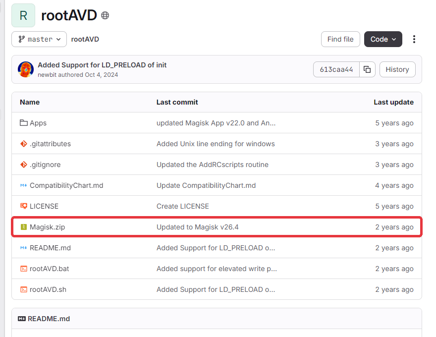
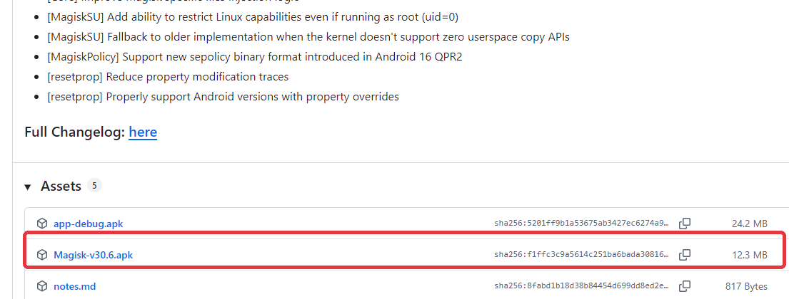
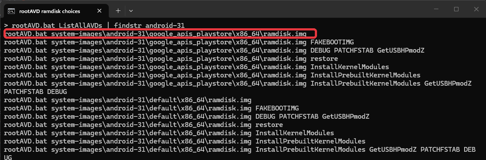
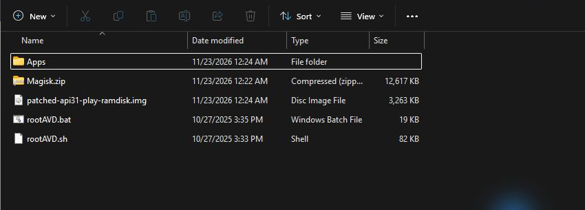
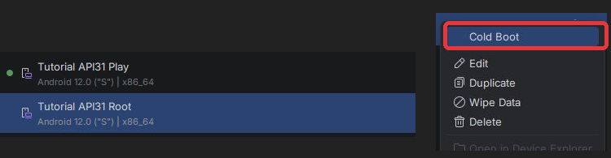
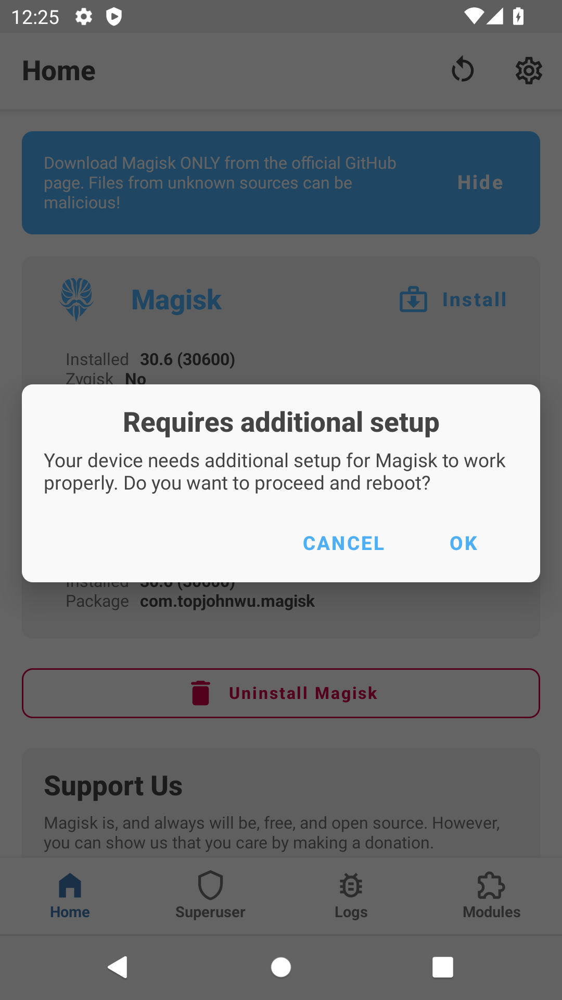
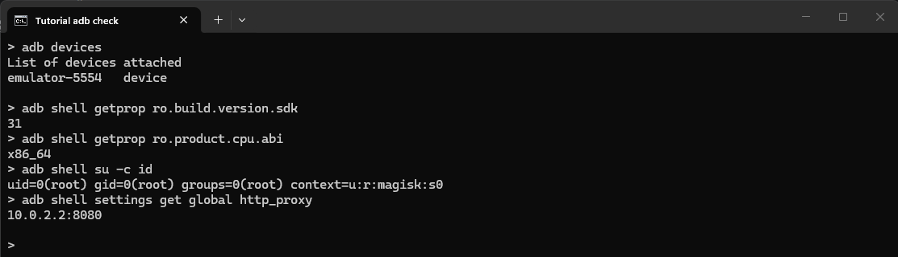
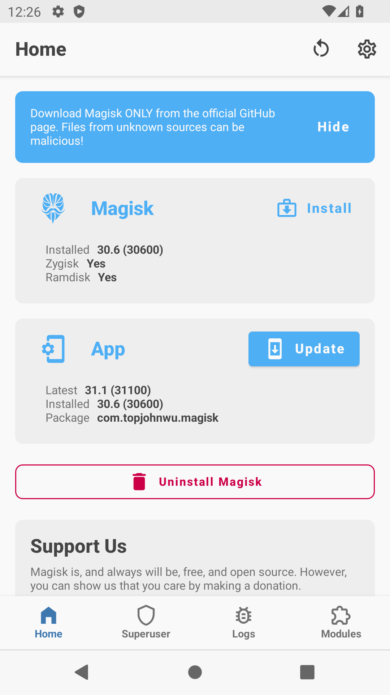
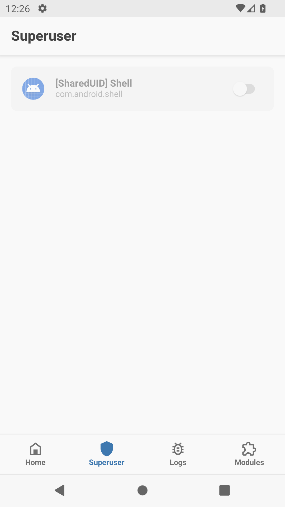

# 6. Root the Play emulator with Magisk

[Previous: APK transfer](05-dual-emulator-apks.md) · [Next: certificates](07-certificates-and-pinning.md)

Root the Play emulator when an app needs the proxy CA in Android's system trust store. The sample app in [chapter 1](01-environment-setup.md) uses a debug setting to trust a user CA, so you can skip this chapter for that app. The steps below use `Tutorial_API31_Play`: Android 12 / API 31, `google_apis_playstore`, x86_64, on Windows 11 with Emulator `36.2.12` and platform tools `36.0.0`.

## 1. Prepare rootAVD and the correct ramdisk

Download [rootAVD](https://gitlab.com/newbit/rootAVD) (the screenshots use commit prefix `613caa4`) and official [Magisk 30.6](https://github.com/topjohnwu/Magisk/releases). Start only `Tutorial_API31_Play`. Its `adb root` command will be rejected because this is a production image.





```powershell
$env:ANDROID_HOME = "$env:LOCALAPPDATA\Android\Sdk"
$env:PATH = "$env:ANDROID_HOME\platform-tools;$env:ANDROID_HOME\emulator;$env:PATH"
adb devices
adb shell getprop ro.build.version.sdk
adb shell getprop ro.product.cpu.abi
```

The ramdisk to patch is `system-images\android-31\google_apis_playstore\x86_64\ramdisk.img` under the SDK. [rootAVD's README](https://gitlab.com/newbit/rootAVD/-/blob/master/README.md) shows the path format for other images. Save a stock copy in your rootAVD folder, then put the official Magisk APK there as `Magisk.zip`. Verify the download against its official release.

```powershell
cd C:\path\to\rootAVD
Copy-Item "$env:ANDROID_HOME\system-images\android-31\google_apis_playstore\x86_64\ramdisk.img" .\api31-play-stock-ramdisk.img
Invoke-WebRequest 'https://github.com/topjohnwu/Magisk/releases/download/v30.6/Magisk-v30.6.apk' -OutFile .\Magisk.zip
Get-FileHash .\Magisk.zip -Algorithm SHA256
& .\rootAVD.bat ListAllAVDs
```





On Windows, run `where.exe find` before patching. If Git Bash or Conda supplies `find` before `C:\Windows\System32\find.exe`, stop and follow the [rootAVD PATH fix](troubleshooting.md). The patch fails in confusing ways otherwise.

## 2. Patch, save, and boot

With the Play AVD running, patch its SDK ramdisk:

```powershell
& .\rootAVD.bat 'system-images\android-31\google_apis_playstore\x86_64\ramdisk.img'
```

The script shuts down the AVD. Save the patched file separately, restore the stock SDK image, and launch this AVD with the patch explicitly:

```powershell
Copy-Item "$env:ANDROID_HOME\system-images\android-31\google_apis_playstore\x86_64\ramdisk.img" .\patched-api31-play-ramdisk.img
& .\rootAVD.bat 'system-images\android-31\google_apis_playstore\x86_64\ramdisk.img' restore
emulator -avd Tutorial_API31_Play -ramdisk C:\path\to\rootAVD\patched-api31-play-ramdisk.img -no-snapshot-load
```

In Device Manager, **Cold Boot** starts an AVD without a saved snapshot. For this patched Play image, use the `emulator -ramdisk` command above so it boots the saved patch.



Open Magisk. If it says **Requires additional setup**, complete that prompt and reboot before checking root.



## 3. Verify root and Shell permission

In Magisk's Superuser screen, allow the Shell request, then check:

```powershell
adb wait-for-device
adb shell su -c id
```

Look for `uid=0` and `context=u:r:magisk:s0`, as in the screenshot. The Magisk app icon is not a root check.







If **Requires additional setup** returns after reboot, stop before installing modules. Follow the [Magisk troubleshooting row](troubleshooting.md) and compare your image and Magisk version with [the setup used here](08-compatibility.md). If those match, Magisk's [installation guide](https://topjohnwu.github.io/Magisk/install.html) is the next place to look.
