# 7. Intercept HTTPS and test pinning

[Previous: Magisk](06-rootavd-magisk.md) · [Next: compatibility](08-compatibility.md)

This chapter uses the rooted API 31 Play AVD from [chapter 6](06-rootavd-magisk.md), mitmproxy `12.1.2`, [AlwaysTrustUserCerts 1.3](https://github.com/NVISOsecurity/AlwaysTrustUserCerts), and the official [HTTP Toolkit SSL pinning demo](https://github.com/httptoolkit/android-ssl-pinning-demo) APK `1.7.1`. The demo provides separate unpinned and pinned requests.

Download the demo APK from its [official releases](https://github.com/httptoolkit/android-ssl-pinning-demo/releases), then install it on the rooted AVD:

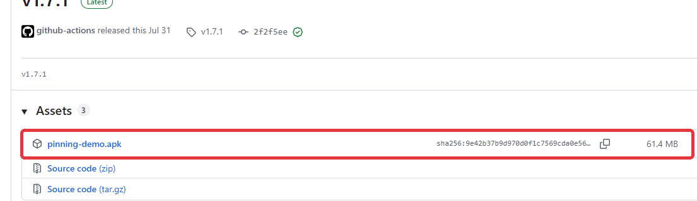

```powershell
adb install -r C:\path\to\ssl-pinning-demo.apk
```

## 1. Route the emulator through mitmproxy

Start mitmdump on the Windows host:

```powershell
mitmdump --listen-host 127.0.0.1 --listen-port 8080 -w .\capture-advanced.mitm
```

In another PowerShell terminal, set the Android system proxy and copy mitmproxy's public CA certificate:

```powershell
adb shell settings put global http_proxy 10.0.2.2:8080
adb shell settings get global http_proxy
adb push "$env:USERPROFILE\.mitmproxy\mitmproxy-ca-cert.cer" /sdcard/Download/mitmproxy-ca-cert.cer
```

This is the same route as [chapter 2](02-https-interception.md). Push only the public `.cer` file; `mitmproxy-ca.pem` holds the private key and stays on your PC.

In Android Settings, open **Security → Encryption & credentials → Install a certificate → CA certificate** and select the `.cer` file. Menu names vary. Choose **CA certificate**, not Wi-Fi certificate. Confirm it appears in User trusted credentials.

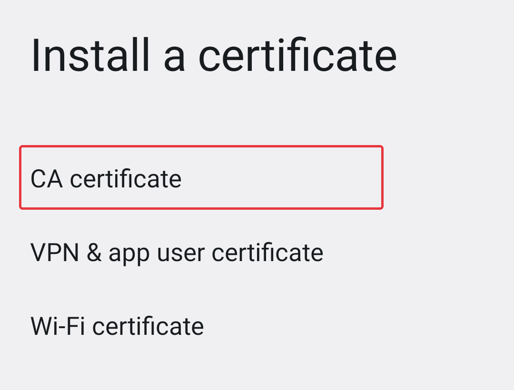{ width="360" }

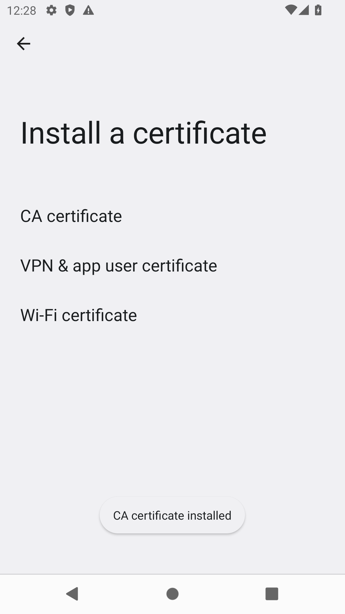{ width="360" }

Try the demo's unpinned button now. It fails on this API 31 Play image because the app does not trust the user CA. The rebuilt sample app in [chapter 1](01-environment-setup.md) uses `debug-overrides` to trust that CA without root.

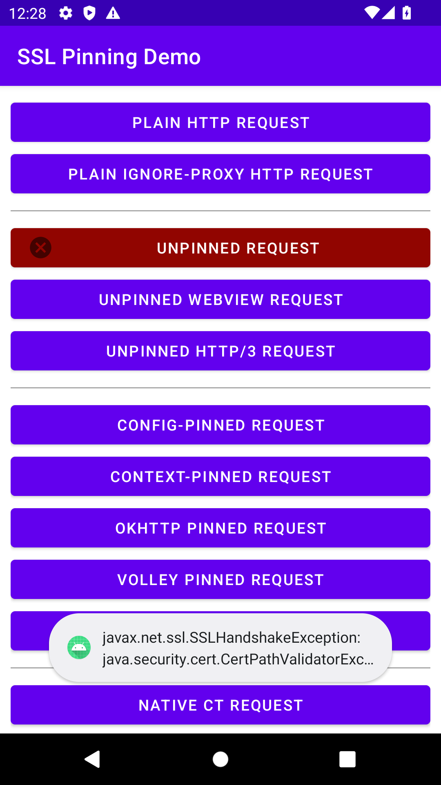{ width="360" }

Certificate pinning adds another check: the app expects a particular server certificate or public key. It can reject mitmproxy's certificate even after Android trusts the proxy CA. In this demo, moving the CA into system trust fixes the unpinned request, but the pinned buttons still fail.

## 2. Add the user CA to system trust

With `adb shell su -c id` working, download the official AlwaysTrustUserCerts `v1.3` ZIP. Copy and install it with Magisk:

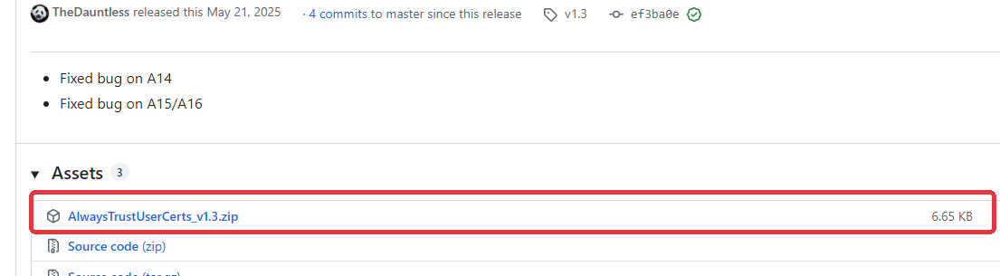

```powershell
adb push .\AlwaysTrustUserCerts_v1.3.zip /data/local/tmp/AlwaysTrustUserCerts_v1.3.zip
adb shell ls -l /data/local/tmp/AlwaysTrustUserCerts_v1.3.zip
adb shell su -c 'magisk --install-module /data/local/tmp/AlwaysTrustUserCerts_v1.3.zip'
adb shell su -c sync
```

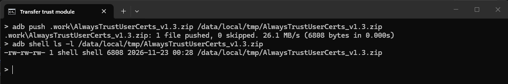

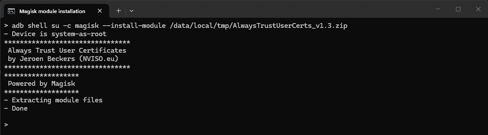

Cold boot the AVD with the patched ramdisk saved in [chapter 6](06-rootavd-magisk.md). Magisk stages the module update until reboot, so **"Done" is not the final check**. Check that the CA appears in the system store; on this image its filename is `c8750f0d.0`:

```powershell
adb shell su -c 'ls -l /system/etc/security/cacerts/c8750f0d.0'
adb shell su -c 'ls /data/adb/modules'
```

If the CA file is still missing after the cold boot, stop here and use the [module "Done" troubleshooting row](troubleshooting.md).

On other Android versions, the module may use the Conscrypt APEX certificate location; see its [README](https://github.com/NVISOsecurity/AlwaysTrustUserCerts).

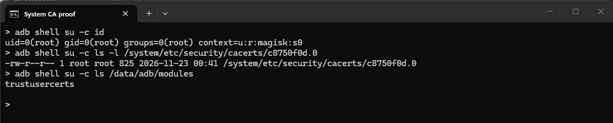

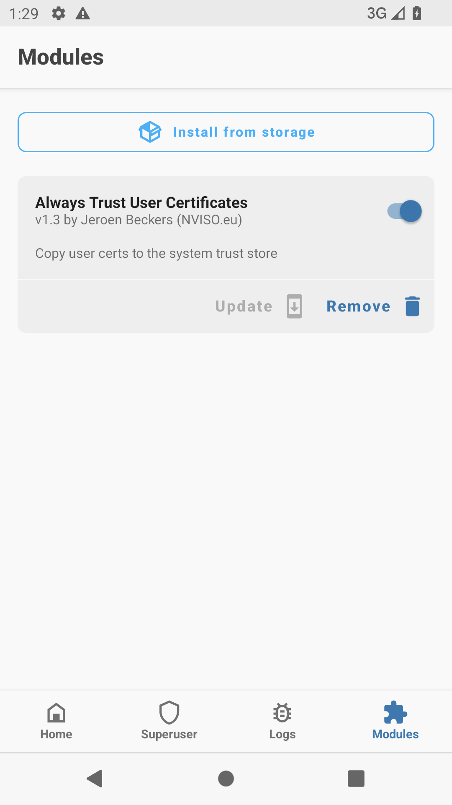{ width="360" }

These two screenshots are from Charles, but they show what to look for in Android Settings: the proxy CA under **User** after installation, then under **System** once it is in system trust. The mitmproxy certificate makes the same move.

| Installed in User credentials | Present in System credentials |
| --- | --- |
| 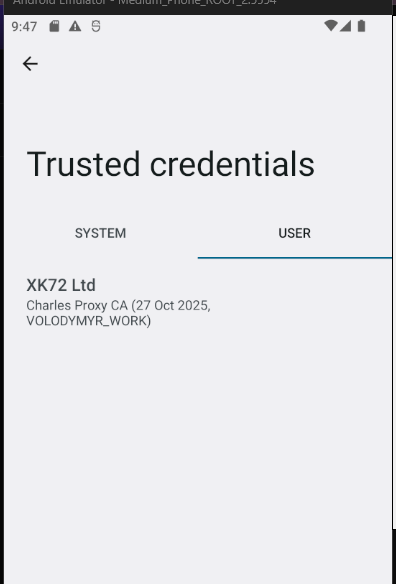{ width="300" } | 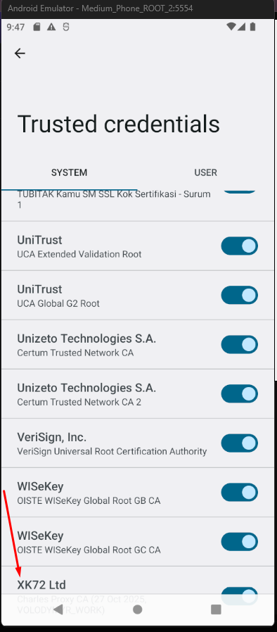{ width="300" } |

## 3. Compare unpinned and pinned requests

Open the demo and try its three request buttons while watching mitmdump:

| Demo button | Result after system CA module |
| --- | --- |
| Unpinned | Succeeded; mitmproxy showed the decrypted GET |
| Network-config pinned | Failed |
| OkHttp pinned | Failed with an explicit pinning error |

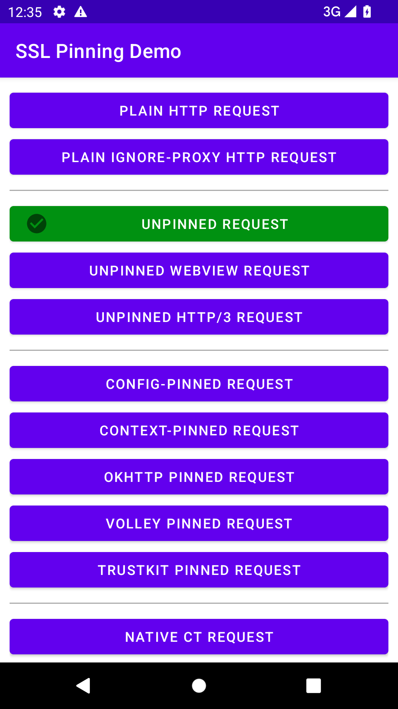{ width="360" }

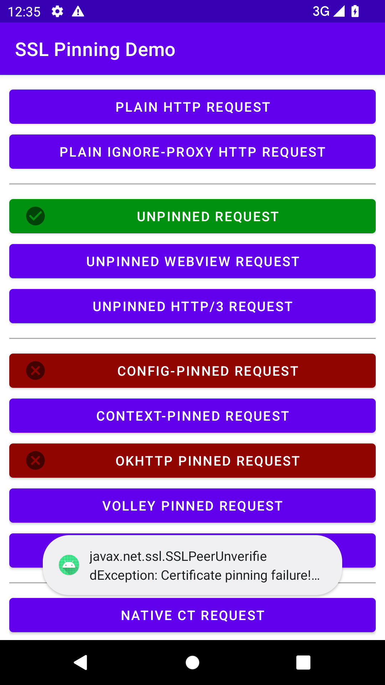{ width="360" }

So the route and CA trust work. The pinned buttons fail because of the app's own checks: one uses pins declared in its [network security configuration](https://developer.android.com/privacy-and-security/security-config), the other uses OkHttp's `CertificatePinner`.

## Optional: hook this demo's OkHttp pin check

I ran Frida server `17.27.4` for x86_64 on the rooted AVD, with `frida` `17.27.4` and `frida-tools` `14.13.2` on Windows. Download and unpack the matching server from [Frida releases](https://github.com/frida/frida/releases), then place it on the AVD and start it as root:

```powershell
adb push .\frida-server /data/local/tmp/frida-server
adb shell su -c 'chmod 755 /data/local/tmp/frida-server'
adb shell su -c '/data/local/tmp/frida-server -D'
python -m pip install frida==17.27.4 frida-tools==14.13.2
```

With the demo app running, load the [targeted hook](../examples/frida/okhttp-demo-unpin.js) from the guide's root directory:

```powershell
frida -U -n 'SSL Pinning Demo' -l .\examples\frida\okhttp-demo-unpin.js -q --eternalize -t 3
```

Press **OKHTTP PINNED REQUEST** again. The button should turn green and mitmproxy should show `GET https://rsa8192--untrusted-root.testserver.host/`. The script hooks `okhttp3.CertificatePinner.check` and `check$okhttp` for that demo hostname.

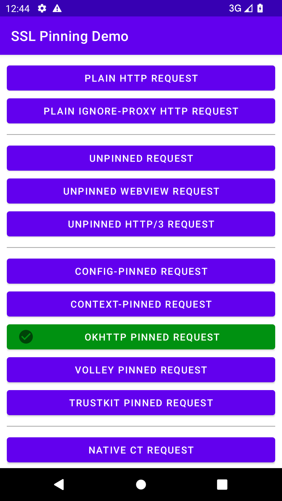{ width="360" }

For missing requests, TLS errors, and cleanup after the exercise, use [troubleshooting](troubleshooting.md). After removing the user CA, reboot so the module updates its system copy.
