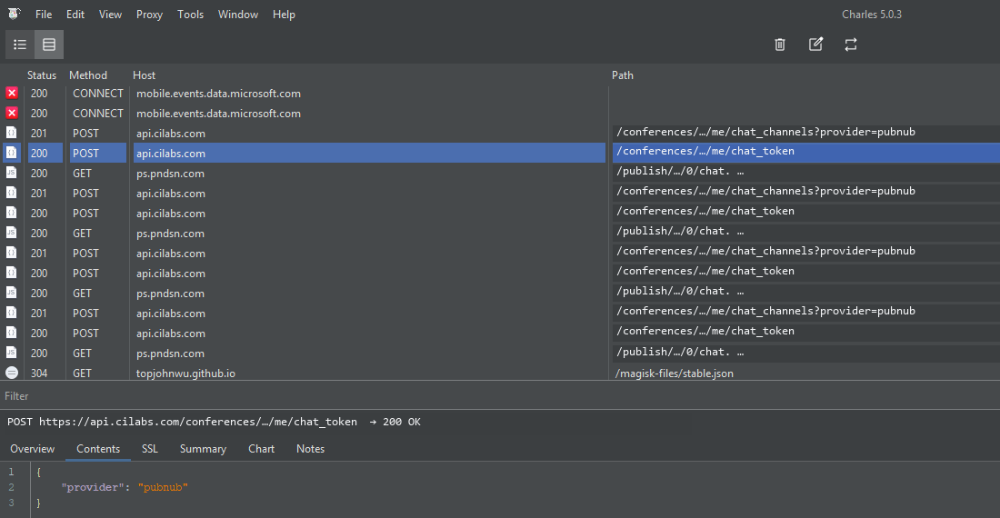
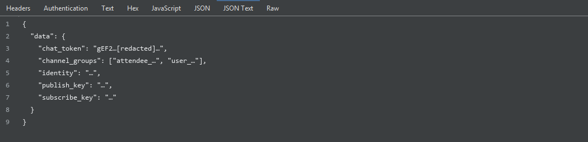

# 9. Applying the method to an authorized app

[Previous: compatibility](08-compatibility.md) · [Back to overview](index.md)

## Permission and personal data

Before capturing a real app, define whose app, account, and data you may inspect. Use a test account you control or written permission that names the systems and actions in scope. A login is not blanket permission to probe other accounts or endpoints. The EU's [information-systems directive](https://eur-lex.europa.eu/eli/dir/2013/40/oj/eng/pdf) addresses access and interception *without right*. If captured responses contain personal data, the [GDPR](https://eur-lex.europa.eu/eli/reg/2016/679/oj/eng/) requires a lawful basis, a defined purpose, and data minimization. Check the app's terms and applicable local law before collecting or reusing data. This is a workflow checklist, not a legal determination for a particular target.

Keep raw proxy sessions private: they can contain passwords, session cookies, access tokens, and other people's records. Use only the fields necessary for the permitted task. Set a retention period and remove tokens from logs and screenshots.

## From one screen to one request

1. Sign in with your permitted account, then perform **one** action in the app. Filter Charles or mitmweb to the app's approved host. Compare the request list before and after the action.
2. Record the request's **method, host, path, query or JSON body, response shape, and pagination**. Separate necessary headers from device telemetry. In my Charles capture below, you can see the host, route shape, request body, status, and response fields. I replaced the event ID, account IDs, and most of the token value.
3. If the app exchanges a login authorization code for an access token, the code is usually a one-time input to that exchange. For a replay, use a current access token from **your own** authorized session, within its original scope. Do not publish it or treat another user's token as yours.
4. Reproduce one **read-only** request and compare its status and fields with the app screen. A `401` or `403` means stop and reauthenticate or check scope; a `429` means wait for the server's retry window. Do not turn an observed state-changing request into a bulk job without explicit permission.



The response pane keeps the original field names; I replaced the credential and account values before publication. The `chat_token` field is the service token returned by this exchange, not a value to paste into a public script.



Some apps use a second exchange: an account session obtains a scoped service token, then a resource request uses that token. Preserve the observed sequence and required headers within your permission scope. Keep tokens out of source files and leave TLS verification enabled.

The screenshot shows a token exchange. For a first replay, find the **read-only GET** that follows it. Copy its method, host, path, query, and response field names into your notes. Keep the live token and account IDs out of the notes, screenshots, and source code.

Use the [read-only Python skeleton](../examples/authorized-api-skeleton.py) from this guide's root folder. Replace the example URL and path with the approved GET you observed:

```powershell
$env:APP_API_BASE_URL = 'https://your-approved-api.example'
$env:APP_READ_PATH = '/items'
$env:APP_QUERY_JSON = '{"limit":1}'
$env:APP_ACCESS_TOKEN = (Get-Credential -UserName token -Message 'Enter your own access token as the password').GetNetworkCredential().Password
.\.venv\Scripts\python.exe -m pip install httpx
.\.venv\Scripts\python.exe .\examples\authorized-api-skeleton.py
Remove-Item Env:APP_ACCESS_TOKEN
```

It prints the HTTP status and JSON keys. Check those against the captured response before adding field mapping or pagination. For a complete working export against the public sample API, see the [DummyJSON exporter](../scraper/main.py).
