# From Android screen to Python scraper

A visual walkthrough using an [open-source shopping app](https://github.com/Hasuk1/dummyjson_products) and its public [DummyJSON](https://dummyjson.com/docs/products) backend. Capture the app's HTTPS requests, find the products API, and export its data with Python.

There are two paths through this guide. Chapters 1 to 4 are the [basic path](01-environment-setup.md): rebuild the sample app, capture its HTTPS traffic, and export products with Python. Chapters 5 to 8 are the [advanced path](05-dual-emulator-apks.md) for apps that need Play services, root, system CA trust, or pinning tests. [Chapter 9](09-authorized-real-app.md) applies the method to a real app you are allowed to inspect.

Everything here was tested on Windows 11, and the commands are PowerShell. The basic path works because you can edit the sample's source to trust the proxy CA. You can't do that with a closed APK, which is why the advanced path exists.

## 1. Launch the app

Install [Android Studio](https://developer.android.com/studio), Python 3, JDK 17, Gradle 8.13, and [mitmproxy](https://docs.mitmproxy.org/stable/overview/installation/). In Android Studio's **Device Manager**, create a Pixel 6 / Android 13 (API 33) / Google APIs x86_64 emulator.

Clone the [sample app](https://github.com/Hasuk1/dummyjson_products) at commit `2de8b8ff7fb313e16742117ac31b7c66dfe86e51`. Follow the [build instructions](01-environment-setup.md) to enable debug-only proxy CA trust, accept decimal prices, and install the APK. I used Windows 11, `adb` 36.0.0, Emulator 36.2.12, mitmproxy 12.1.2, and Python 3.12.5 for these screenshots.

| Source to clone | Manifest: add debug CA config | Model: accept decimal prices |
| --- | --- | --- |
| 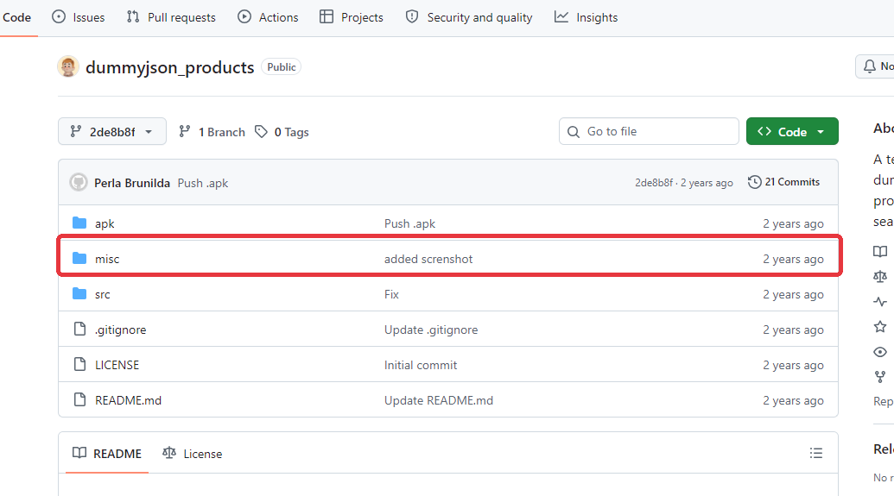 | 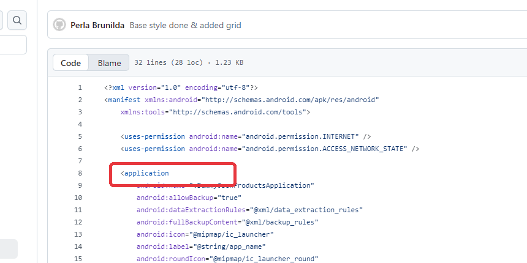 | 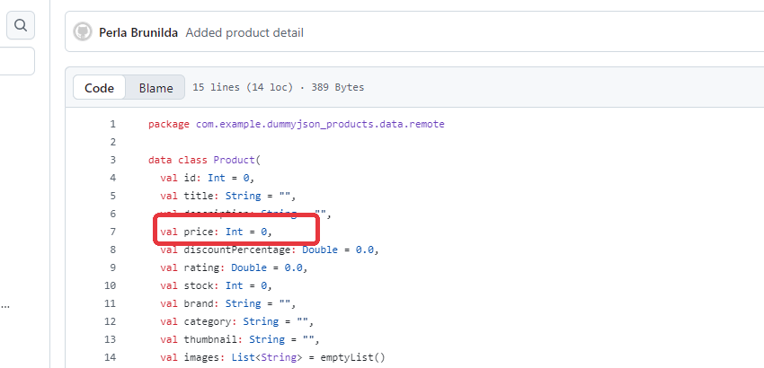 |

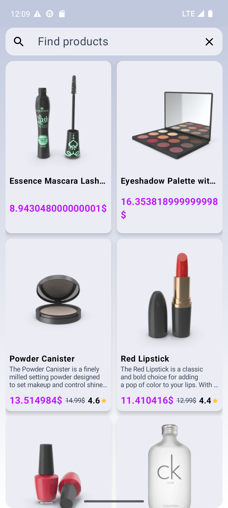

## 2. Route HTTPS through the proxy

Start mitmproxy on Windows:

```powershell
mitmdump --listen-host 127.0.0.1 --listen-port 8080 -w .\capture.mitm
```

In a second PowerShell window, point Android at the host:

```powershell
adb shell settings put global http_proxy 10.0.2.2:8080
adb push "$env:USERPROFILE\.mitmproxy\mitmproxy-ca-cert.cer" /sdcard/Download/mitmproxy-ca-cert.cer
```

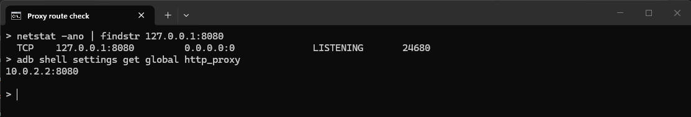

In Android Settings, choose **Security → More security settings → Encryption & credentials → Install a certificate → CA certificate**. Pick the downloaded `.cer`, then check it under **Trusted credentials → User**.

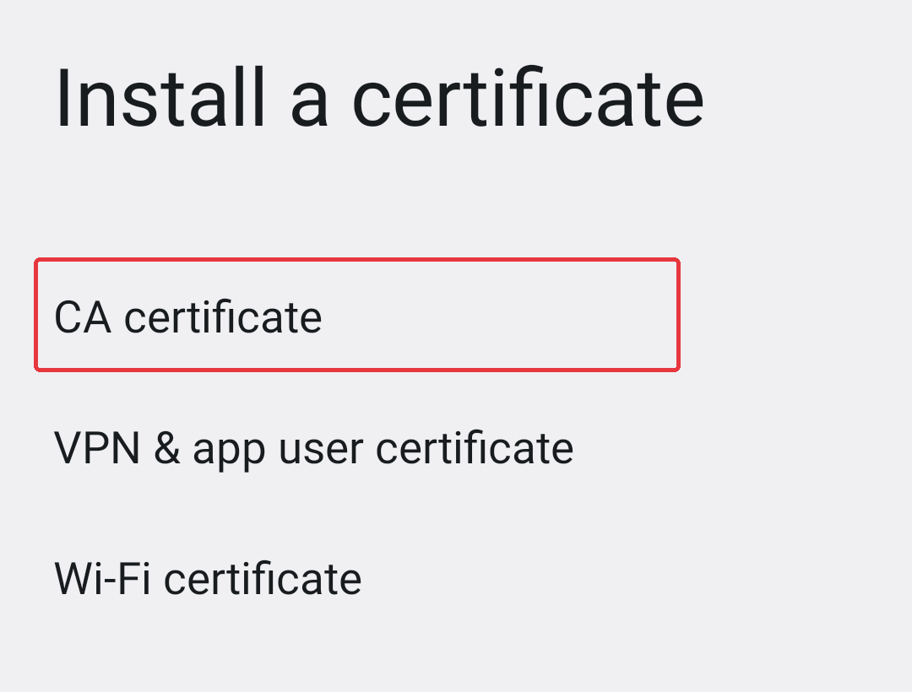

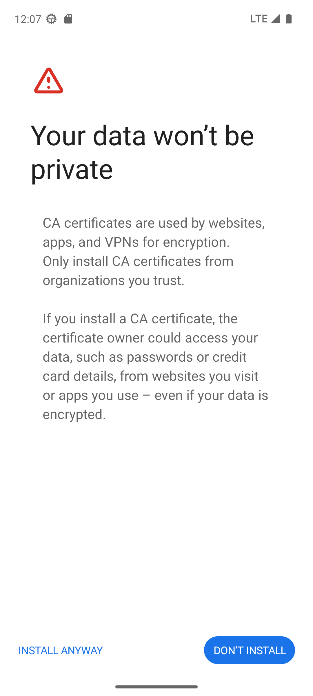

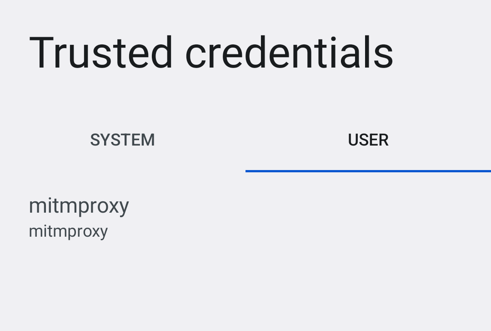

The app's debug-only trust setting from step 1 lets it use this user CA. [Full proxy and certificate steps](02-https-interception.md).

Before capturing the app, check the route with a public page in the emulator browser. I took this screenshot in Charles, but the check is the same in mitmproxy, which every command in this guide uses: searching for "nvidia stock" produced matching `GET` requests with `200` responses.

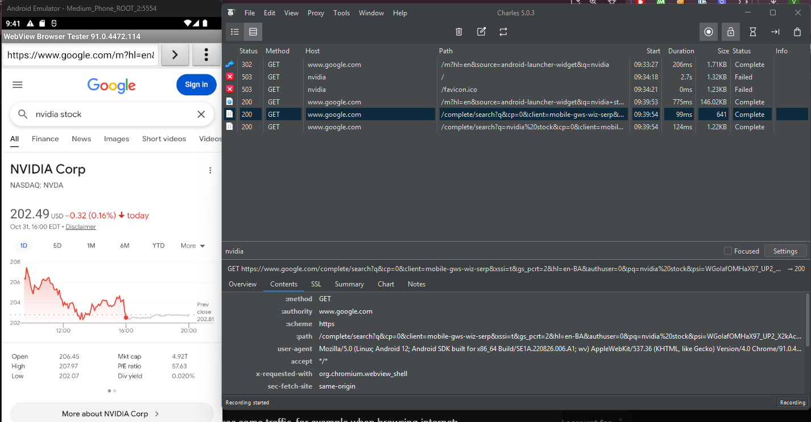

## 3. Tap a screen; read its request

Restart the app, then open the list, tap a product, search for `phone`, and scroll. Stop mitmdump with Ctrl+C, then open its saved capture in mitmweb:

```powershell
mitmweb --listen-host 127.0.0.1 --listen-port 8082 --web-host 127.0.0.1 --web-port 8081 --set web_password=tutorial -r .\capture.mitm
```

Open `http://127.0.0.1:8081` and filter the flows with `~d ^dummyjson.com$`. Set your own local web password if you keep the viewer running.

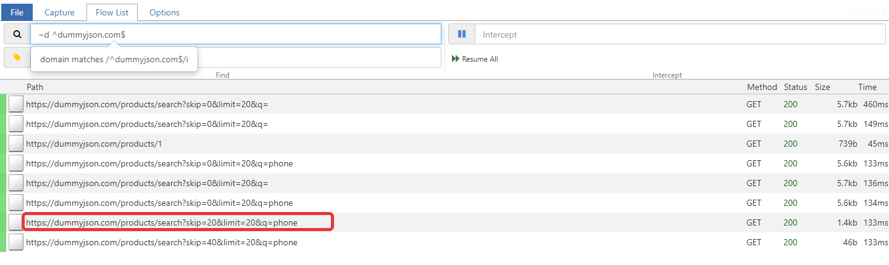

Tap a product:

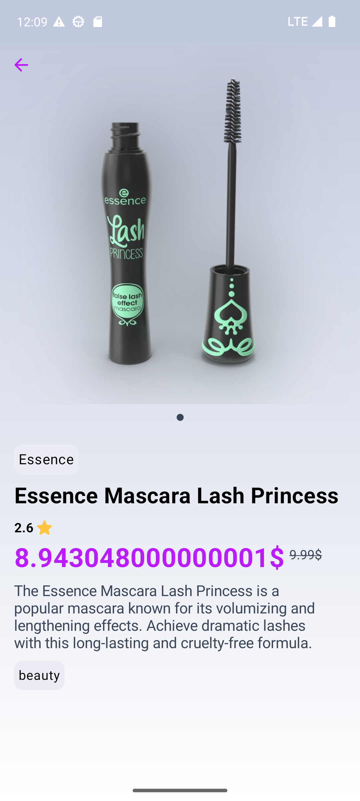

The corresponding request is `GET /products/1`. It returns one JSON product.

Search for `phone`:

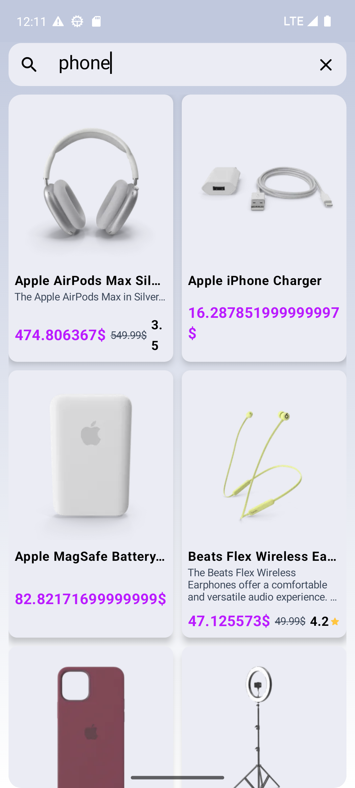

The app requests `GET /products/search?skip=0&limit=20&q=phone`. In the captured response, `total` was 23. Scrolling requested `skip=20` for the remaining three products.

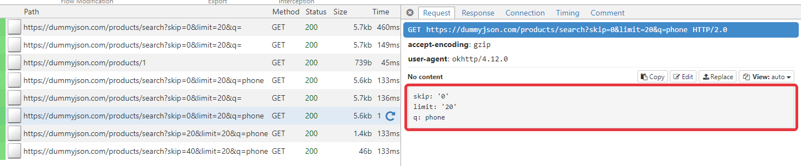

The list uses the same endpoint with an empty `q`; product detail uses `/products/{id}`. See the [screen-to-request walkthrough](03-api-discovery.md) and [sanitized JSON examples](../examples/sanitized-responses/). The live product total may change.

## 4. Export with Python

From this guide's root folder:

```powershell
python -m venv .venv
.\.venv\Scripts\python.exe -m pip install -r .\scraper\requirements.txt
.\.venv\Scripts\python.exe .\scraper\main.py --query phone --max-items 40 --format csv --output .\phones.csv
```

Open `phones.csv`. The [scraper](../scraper/main.py) follows the observed `q`, `skip`, and `limit` parameters; it stops at the API's `total`. For JSON and product details, use `--details --format json --output .\products.json`. [Exporter options and verification](04-python-scraper.md).

## Advanced setup: Play services, root, and pinning

Skip this part if the basic path already gave you readable traffic. Some apps need Google Play services to run. A Google Play emulator provides those services but blocks `adb root`. An AOSP emulator gives you a root shell for inspection. Create one of each using Android 12 / API 31 x86_64: `Tutorial_API31_Play` and `Tutorial_API31_Root`. Keep their Android version and architecture the same so you can transfer the app between them. If you need root on the Play image itself, use the Magisk steps below.

| Google Play image | AOSP image |
| --- | --- |
| 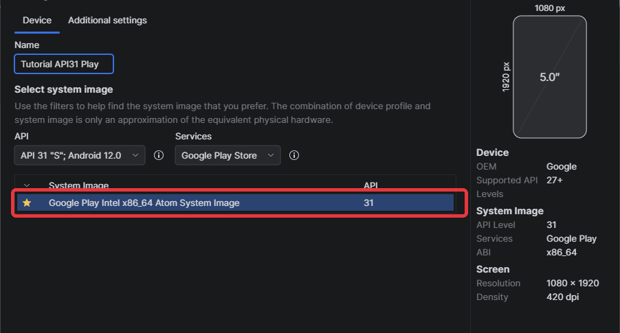 | 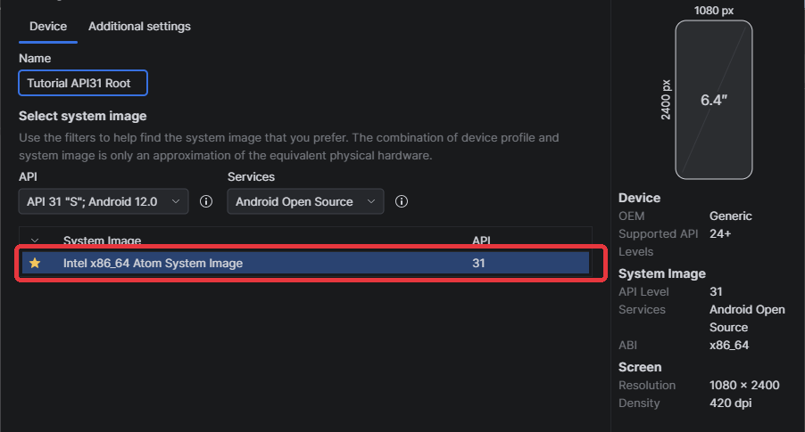 |

### Move every APK split

An app installed from an Android App Bundle may have several APK files. Copying only `base.apk` can leave it broken. For this example, [build the sample app bundle and install it](05-dual-emulator-apks.md) on the Play image with `bundletool`, then list its installed files:

```powershell
adb shell pm path com.example.dummyjson_products
```

This sample has `base.apk`, `split_config.en.apk`, and `split_config.xxhdpi.apk`. It has no Play Store listing, so the example starts with a locally built bundle.

| Play image: bundle-installed app | SAI: export the installed set | AOSP image: run the transferred app |
| --- | --- | --- |
| 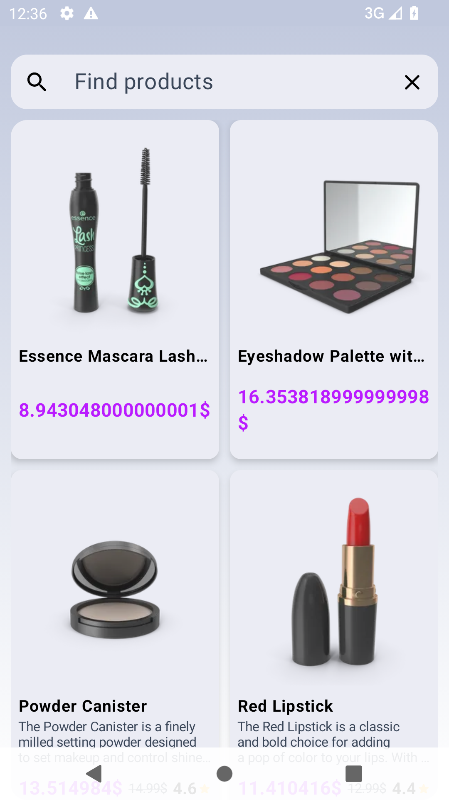 | 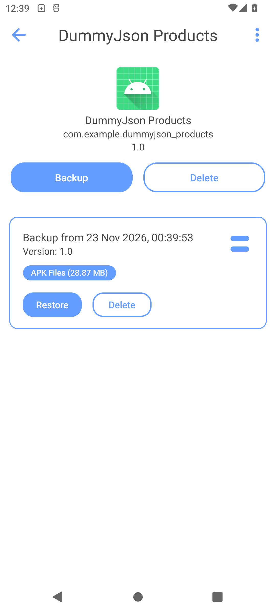 | 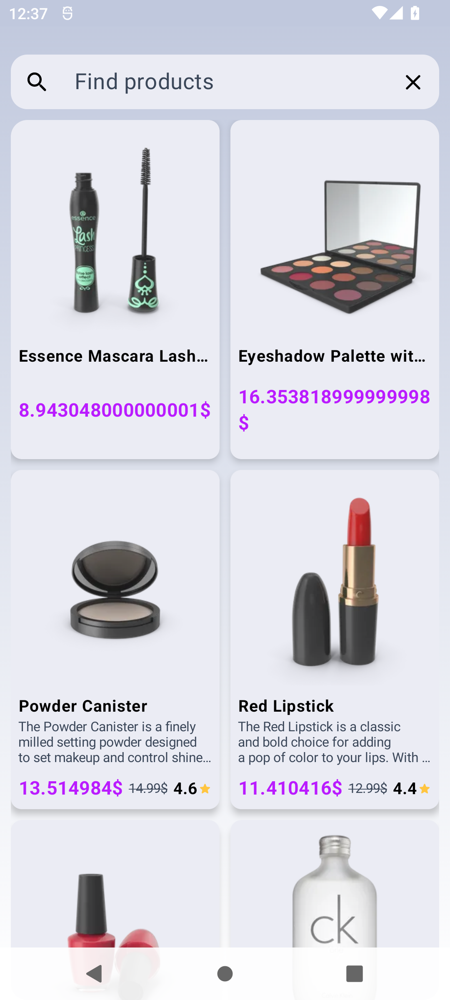 |

Pull every path printed by `pm path`, then install the files together on AOSP with `adb install-multiple`. You can also use SAI 4.5 to export the installed app from AOSP as an `.apks` archive. Open the archive and check that it contains every split.

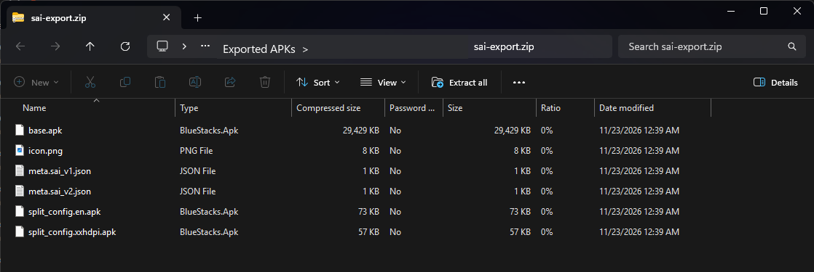

### Root the Play image when system trust is needed

To give the Play image a root shell, download [rootAVD](https://gitlab.com/newbit/rootAVD) and official Magisk 30.6. Patch the API 31 Play image's `ramdisk.img`, save both stock and patched copies, and boot with the patched copy. Complete Magisk's **Requires additional setup** prompt and allow Shell under Superuser. Run `adb shell su -c id`; look for `uid=0`. [Windows commands and PATH fix](06-rootavd-magisk.md).

| rootAVD files | Correct API 31 Play ramdisk |
| --- | --- |
| 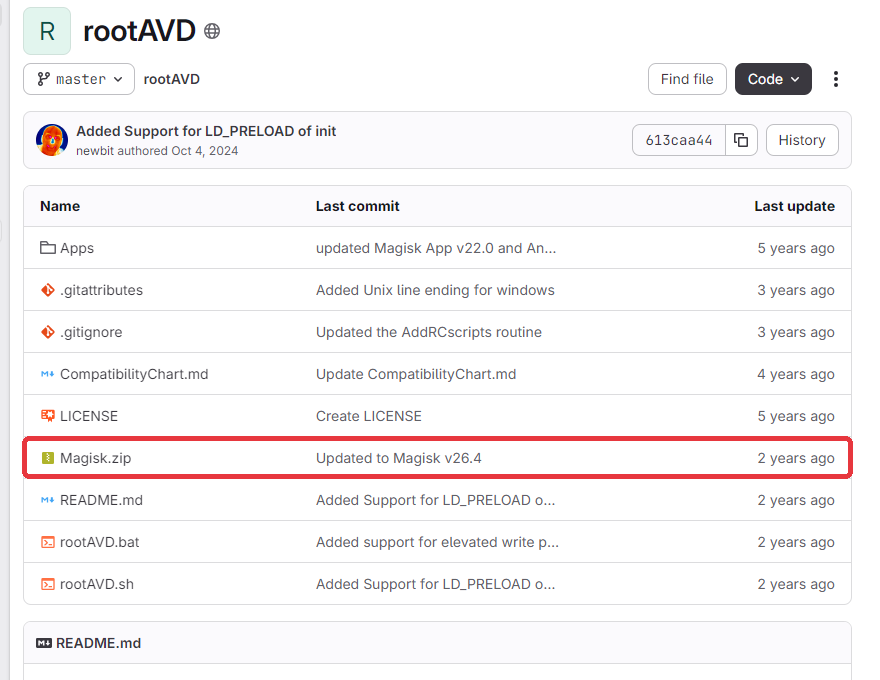 | 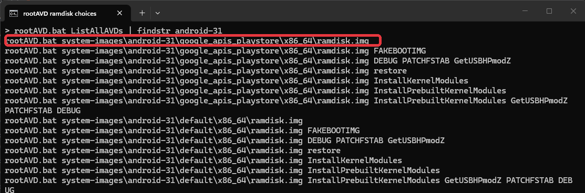 |

| Magisk ready after reboot | Shell authorized for `su` |
| --- | --- |
| 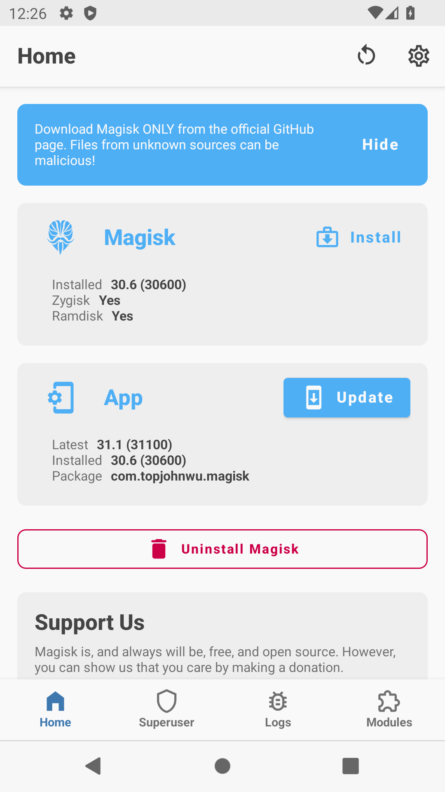 | 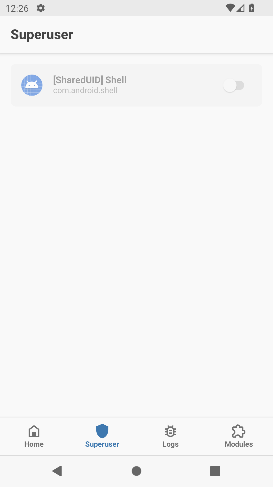 |

### Trust the proxy CA, then test pinning separately

Install mitmproxy's public certificate as an Android **CA certificate**. The unmodified [HTTP Toolkit pinning demo](https://github.com/httptoolkit/android-ssl-pinning-demo) does not trust that user CA. Install [AlwaysTrustUserCerts 1.3](https://github.com/NVISOsecurity/AlwaysTrustUserCerts) in Magisk and cold boot the emulator. The module copies the CA into system trust; the demo's unpinned request should then appear decrypted in mitmproxy. [Certificate and module commands](07-certificates-and-pinning.md).

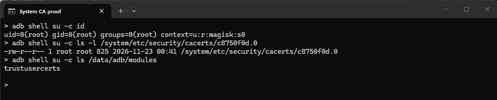

| System CA module active | Unpinned HTTPS now readable |
| --- | --- |
| 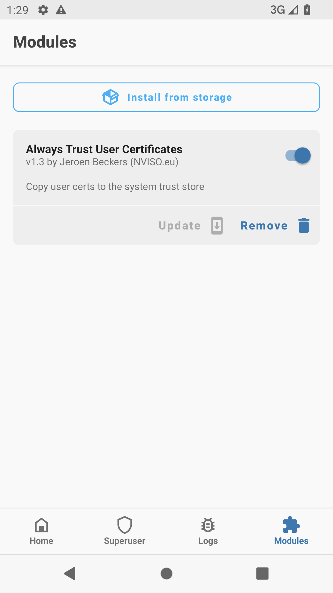 | 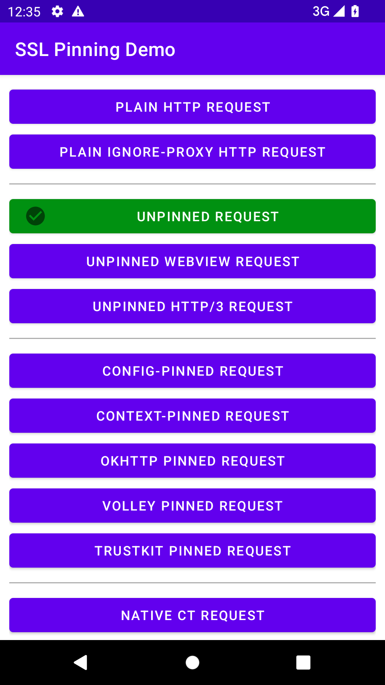 |

After adding the system CA, both pinned requests still failed. I used [Frida](../examples/frida/okhttp-demo-unpin.js) to hook the demo's OkHttp pin check; that request succeeded.

| Both pinned requests fail | OkHttp request succeeds after the hook |
| --- | --- |
| 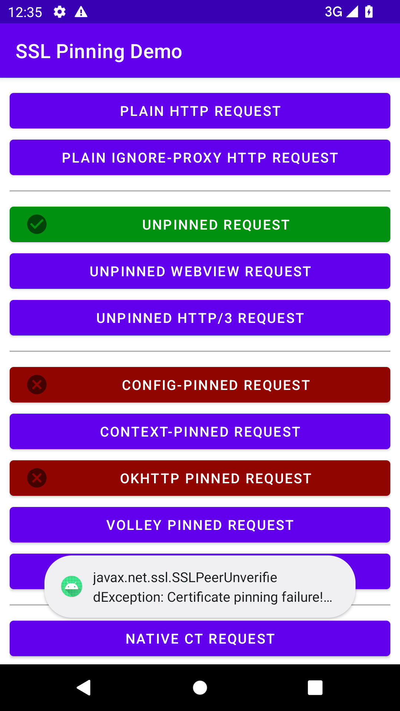 | 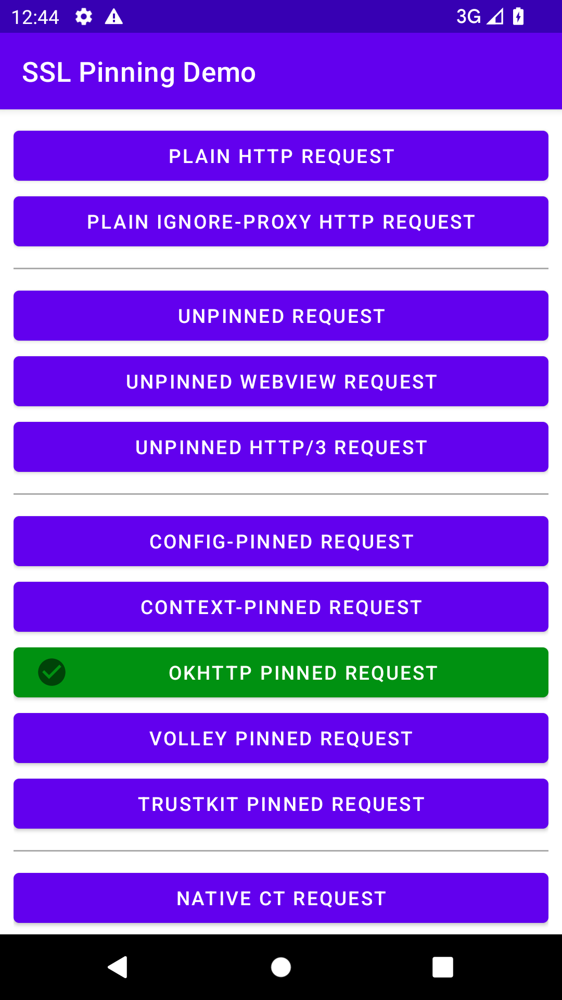 |

See [the emulator setups I verified](08-compatibility.md) before choosing an Android image.

## Applying this to a real app

The [authorized-app workflow](09-authorized-real-app.md) shows how to move from a captured request to a read-only replay using your own account and access token. It includes a redacted real Charles capture, a small Python skeleton, and the permission and personal-data checks to make before collecting anything.

Work only with apps and services you are authorized to inspect. [Troubleshooting and cleanup](troubleshooting.md) covers missing requests, TLS errors, and what to do when finished.
